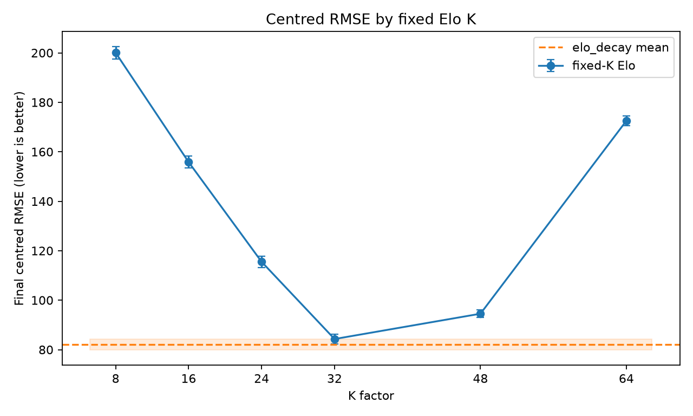
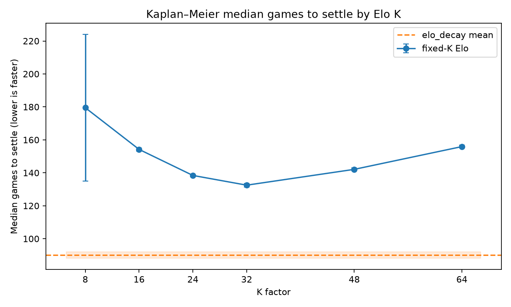

# matchsim — Elo vs Glicko-2 in a simulated ranked queue

[](https://github.com/AryanS0918/matchsim/actions/workflows/tests.yml)

> **Status: step 3 of 5** (Elo, Glicko-2, matchmaking, and the first paired
> experiment results). Smurfs, tilt, churn and the remaining analyses are still
> to come.
> Everything in this repository is a **simulation**. No real player data is used.

## Question

Which rating system finds a player's true skill fastest and gives the fairest
matches? How do smurfs and tilt change that, and what does each system do to
retention? The hypotheses are fixed in advance in [`HYPOTHESES.md`](HYPOTHESES.md).

## Quick start

```bash
pip install -e ".[dev]"
pytest                                   # 28 tests, about 2 s
python scripts/run_baseline.py --seeds 10   # about 45 s at 10k players
```

```python
from matchsim import Elo, SimConfig, run_simulation

res = run_simulation(Elo(k=32), SimConfig(n_players=10_000, n_ticks=500, seed=0))
res.history        # RMSE, Spearman, unfairness and queue stats over time
res.summary()
```

## Layout

```
src/matchsim/
  config.py        SimConfig: every knob in one frozen dataclass
  outcome.py       ground truth: P(win) from the true-skill gap
  ratings/         RatingSystem interface, Elo, EloDecayingK, Glicko-2
  matchmaking.py   closest-rating pairing with a widening queue window; random pairing
  simulation.py    the tick loop, metrics history, per-player settling times
  metrics.py       RMSE (raw and centred), Spearman, unfairness
  replicate.py     multi-seed runs, t-intervals, paired differences
scripts/run_baseline.py
scripts/run_step3_analysis.py
tests/
HYPOTHESES.md
```

## Model

- **Players:** true skill ~ N(1500, 250). The rating systems never see it.
- **Outcomes:** P(A beats B) = 1 / (1 + 10^((s_B − s_A)/400)), drawn as a Bernoulli
  trial. The `outcome_mode="expected"` setting removes the noise; it is used for
  validation.
- **Queue:** each tick, an idle player joins with probability 0.3. Players
  are paired with their closest-rated neighbour if the gap is within
  `50 + 25 × ticks waited` points (capped at 600).
- **Randomness:** one seed spawns separate streams for the population, queue
  entry, matchmaking and outcomes, so arms run on the same seed share a
  population and the comparison is paired.

## Design notes

- **Centred RMSE.** Elo identifies only skill differences, so a common offset
  is removed before computing error. Raw RMSE is reported as well.
- **Settling time, not first passage.** "Games to converge" is the game after
  which a player's error stays within ±100 for the rest of the run. Players
  still outside at the end are right-censored. Starting near the default
  rating does not count as having converged.
- **Matchmaking compresses the rating scale (found while building, see H3).**
  With noiseless outcomes and closest-rating pairing, Elo orders 10k players
  almost perfectly (Spearman ≈ 1.0), but the rating spread barely grows: RMSE
  stays around 230. Players only ever face neighbours, so information about
  scale spreads very slowly up the ladder. With random pairing the same Elo
  converges. The validation test therefore uses random pairing, and
  matchmaking policy is treated as an experimental factor.

## Results (10-seed pilot)

The nearest-pairing, noiseless baseline was re-run at 10,000 players and 500
ticks: centred RMSE **231.73**, Spearman **0.9999985**. This reproduces the
design-note claim.

The sensitivity and H1 pilot used 10 shared seeds, 2,000 players, 500 ticks,
sampled outcomes, and nearest-pairing matchmaking. Intervals below are
unadjusted 95% t-intervals across seeds; settlement medians are estimated with
Kaplan–Meier to account for players still unsettled at the horizon.

| Arm | Centred RMSE (95% CI) | Median games to settle (95% CI) | Prediction log-loss | Favourite win rate | Mean queue time (ticks) |
|---|---:|---:|---:|---:|---:|
| `elo_k32` | 84.30 (82.39, 86.21) | 132.5 (131.4, 133.6) | 0.693001 | 0.5032 | 0.0021 |
| `elo_decay` | 81.99 (79.81, 84.18) | 90.1 (88.1, 92.1) | 0.693033 | 0.5027 | 0.0021 |
| `glicko2` | 138.67 (136.44, 140.91) | 151.5 (150.9, 152.1) | 0.693086 | 0.5021 | 0.0042 |





In the paired H1 contrasts (`glicko2` minus the comparator), Glicko-2 was worse
on both primary metrics: against `elo_decay`, RMSE was **+56.68** (95% CI
52.29–61.07) and median settling time **+61.4 games** (58.92–63.88); against
`elo_k32`, the differences were **+54.38 RMSE** (50.28–58.47) and **+19.0
games** (17.88–20.12). Both intervals exclude zero and exceed their
5-point/5-game practical-effect thresholds, in the direction opposite to H1.
The K grid's RMSE is U-shaped, with its minimum at K=32, but higher K does not
consistently settle faster. `elo_decay` has both lower RMSE and shorter settling
time than every fixed-K arm in this pilot.

Prediction log-loss is the most direct observable A/B metric here: its paired
95% intervals distinguish Glicko-2 from both Elo comparators in this
10-seed pilot, although the absolute differences are small. Plugging those
observed log-loss effects into the power formula gives raw estimates of 10
seeds vs `elo_decay` and 3 vs `elo_k32`; the preregistered minimum is 20 seeds,
so use at least 20 for confirmatory inference. For the primary RMSE effect
threshold of 5, the pilot estimates 12 raw seeds for `glicko2` vs `elo_decay`
and 11 for `glicko2` vs `elo_k32`, also below the 20-seed minimum.

Glicko-2 validation matches [Glickman's worked example](https://www.glicko.net/glicko/glicko2.pdf):
rating **1464.06**, RD **151.52**, and volatility **0.05999**.

Reproduce the pilot with `python scripts/run_step3_analysis.py`; CSV summaries,
paired contrasts, configuration, and the plotted K grid are in [`reports/`](reports/).
The Glicko-2 implementation treats one simulation tick as a rating period.

## Limitations (so far)

- Matches are 1v1. Team games such as Valorant, CoD and PUBG squads aggregate
  skill in ways this model does not capture.
- True skill is fixed (no learning curve), and outcomes follow the same
  logistic curve Elo assumes, so Elo is correctly specified here. A
  misspecified outcome model (probit, or skill varying with map or role) is
  planned as a robustness check.
- Activity is uniform, with no peak hours or player-specific play rates.
- The K-grid pilot does not support a monotonic "higher K settles faster"
  claim, even though its RMSE curve is U-shaped. Its 10-seed, 2,000-player
  result does not establish a general K optimum.
- Glicko-2 passes the worked-example validation but does not support H1's
  predicted convergence ordering in this pilot: it is slower and less accurate
  than both Elo comparators. Its results also depend on treating each tick as
  a rating period.
