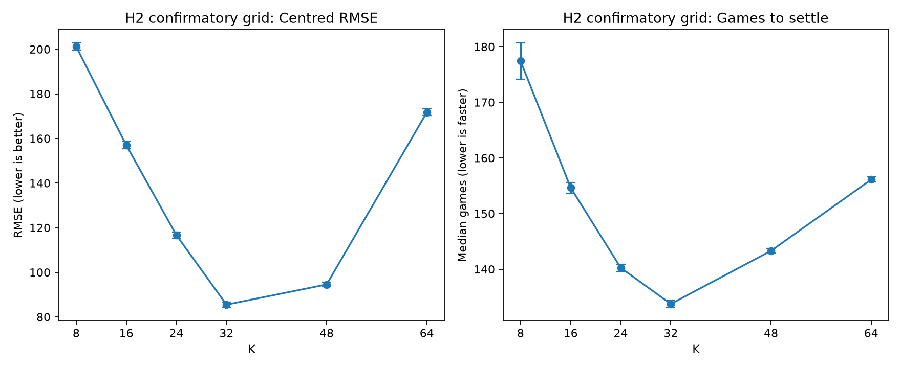
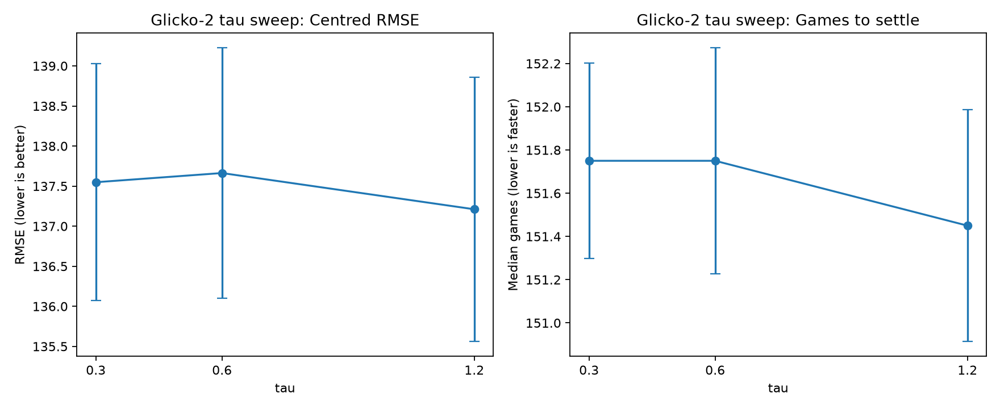

# matchsim — Elo vs Glicko-2 in a simulated ranked queue

[](https://github.com/AryanS0918/matchsim/actions/workflows/tests.yml)

> **Status: step 5 of 5** (The rating models and full confirmatory analysis are
> implemented. Smurf and tilt extensions remain future work.)
> Everything in this repository is a **simulation**. No real player data is used.

## Question

Which rating system finds a player's true skill fastest and gives the fairest
matches? How do smurfs and tilt change that, and what does each system do to
retention? The hypotheses are fixed in advance in [`HYPOTHESES.md`](HYPOTHESES.md).

## Quick start

```bash
pip install -e ".[dev]"
pytest                                   # 29 tests, about 2 s
python scripts/run_baseline.py --seeds 10   # about 45 s at 10k players
```

```python
from matchsim import Elo, SimConfig, run_simulation

res = run_simulation(Elo(k=32), SimConfig(n_players=10_000, n_ticks=500, seed=0))
res.history        # RMSE, Spearman, unfairness and queue stats over time
res.summary()
```

## Layout

```
src/matchsim/
  config.py        SimConfig: every knob in one frozen dataclass
  outcome.py       ground truth: P(win) from the true-skill gap
  ratings/         RatingSystem interface, Elo, EloDecayingK, Glicko-2
  matchmaking.py   closest-rating pairing with a widening queue window; random pairing
  simulation.py    the tick loop, metrics history, per-player settling times
  metrics.py       RMSE (raw and centred), Spearman, unfairness
  replicate.py     multi-seed runs, t-intervals, paired differences
scripts/run_baseline.py
scripts/run_step3_analysis.py
tests/
HYPOTHESES.md
```

## Model

- **Players:** true skill ~ N(1500, 250). The rating systems never see it.
- **Outcomes:** P(A beats B) = 1 / (1 + 10^((s_B − s_A)/400)), drawn as a Bernoulli
  trial. The `outcome_mode="expected"` setting removes the noise; it is used for
  validation.
- **Queue:** each tick, an idle player joins with probability 0.3. Players
  are paired with their closest-rated neighbour if the gap is within
  `50 + 25 × ticks waited` points (capped at 600).
- **Randomness:** one seed spawns separate streams for the population, queue
  entry, matchmaking and outcomes, so arms run on the same seed share a
  population and the comparison is paired.

## Design notes

- **Centred RMSE.** Elo identifies only skill differences, so a common offset
  is removed before computing error. Raw RMSE is reported as well.
- **Settling time, not first passage.** "Games to converge" is the game after
  which a player's error stays within ±100 for the rest of the run. Players
  still outside at the end are right-censored. Starting near the default
  rating does not count as having converged.
- **Matchmaking compresses the rating scale (found while building, see H3).**
  With noiseless outcomes and closest-rating pairing, Elo orders 10k players
  almost perfectly (Spearman ≈ 1.0), but the rating spread barely grows: RMSE
  stays around 230. Players only ever face neighbours, so information about
  scale spreads very slowly up the ladder. With random pairing the same Elo
  converges. The validation test therefore uses random pairing, and
  matchmaking policy is treated as an experimental factor.

## Results (20-seed confirmatory run)

The nearest-pairing, noiseless baseline was re-run at 10,000 players and 500
ticks: centred RMSE **231.73**, Spearman **0.9999985**. This reproduces the
design-note claim.

The confirmatory sensitivity and H1/H2 run used 20 shared seeds, 2,000 players,
500 ticks, sampled outcomes, and nearest-pairing matchmaking. Settlement
medians use Kaplan–Meier right-censoring. Primary paired contrasts use 95%
t-intervals and Holm correction within the H1/H2 contrast family.

| Arm | Centred RMSE (95% CI) | Median games to settle (95% CI) |
|---|---:|---:|
| `elo_k32` | 85.48 (84.29, 86.67) | 133.75 (133.15, 134.35) |
| `elo_decay` | 83.10 (81.68, 84.51) | 93.60 (91.12, 96.08) |
| `glicko2_tau0.6` | 137.66 (136.10, 139.23) | 151.75 (151.23, 152.27) |





### Hypothesis results

- **H1 — Falsified.** Glicko-2 was worse than both Elo comparators after Holm
  correction. Against `elo_decay`, RMSE differed by **+54.57** (95% CI
  51.61–57.52) and settling by **+58.15 games** (55.40–60.90). Against
  `elo_k32`, RMSE differed by **+52.18** (49.48–54.89) and settling by
  **+18.00 games** (17.18–18.82). The ordering was not
  `glicko2 < elo_decay < elo_k32`.
- **H2 — Supported for accuracy, not the full trade-off.** Fixed-K RMSE has a
  U-shaped grid with its minimum at K=32. The decay arm has lower RMSE and
  materially faster settling than Elo K32; Glicko-2 does not lie on the
  favourable frontier. The grid did not support the claim that larger K always
  settles faster.
- **H3 — Supported qualitatively.** Nearest-pairing compresses the Elo rating
  scale: 10,000-player noiseless RMSE was 231.73 while Spearman rank correlation
  remained 0.9999985. This is the mismatch described by H3.
- **H4 — Not tested.** Fairness buckets and the 20-game/100-game transition
  require separate event-history analysis and are still pending.
- **H5 — Not tested.** The smurf mechanism and smurf-only survival outcomes are
  not yet implemented.
- **H6 — Not tested.** The tilt mechanism and sensitivity grid are not yet
  implemented.
- **H7 — Falsified under the implemented loss-streak mechanism.** A seed-clustered
  Cox model found every Elo-decay and Glicko-2 hazard ratio against `elo_k32`
  above 1. Threshold 3: decay **1.084** (1.074–1.094), Glicko-2 **1.066**
  (1.054–1.078). Threshold 5: decay **1.135** (1.121–1.149), Glicko-2 **1.253**
  (1.233–1.274). Threshold 8: decay **1.158** (1.124–1.192), Glicko-2 **1.459**
  (1.414–1.506). Thus both arms churn sooner than fixed-K Elo under this model,
  opposite to H7.

The Glicko-2 tau sweep at 0.3, 0.6 and 1.2 changed neither RMSE nor settling
meaningfully: centred RMSE was 137.55, 137.66 and 137.21, and median settling
was 151.75, 151.75 and 151.45 games, respectively. This does not explain H1's
failure by tau choice.

Glicko-2 validation matches [Glickman's worked example](https://www.glicko.net/glicko/glicko2.pdf):
rating **1464.06**, RD **151.52**, and volatility **0.05999**.

Reproduce the analysis with:

```bash
python scripts/run_confirmatory_analysis.py --players 2000 --ticks 500 --seeds 20
python scripts/run_h7_churn.py --players 2000 --ticks 500 --seeds 20
```

CSV summaries and plots are in [`reports/`](reports/); the Glicko-2 implementation
treats one simulation tick as a rating period.

## Limitations (so far)

- Matches are 1v1. Team games such as Valorant, CoD and PUBG squads aggregate
  skill in ways this model does not capture.
- True skill is fixed (no learning curve), and outcomes follow the same
  logistic curve Elo assumes, so Elo is correctly specified here. A
  misspecified outcome model (probit, or skill varying with map or role) is
  planned as a robustness check.
- Activity is uniform, with no peak hours or player-specific play rates.
- The 20-seed K grid does not support a monotonic "higher K settles faster"
  claim, even though its RMSE curve is U-shaped.
- Glicko-2 passes the worked-example validation but does not support H1's
  predicted convergence ordering: it is slower and less accurate than both Elo
  comparators across the τ sweep.
- H7's hazard ratios measure the assumed loss-streak churn mechanism, not real
  player retention. The results are therefore mechanism-dependent.
